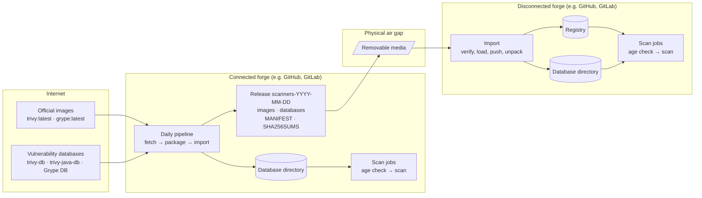

# airgap-vuln-scan

Scan container images with Trivy and Grype where there's no internet: the scanners and their
vulnerability databases are prepared on a connected system, carried across the gap, and checked
for age before every scan.

## Problem

Vulnerability scanners download their databases when a scan starts.

* **A system with no internet can't.** The official Trivy and Grype images hold only the scanner,
  so pulling the latest images isn't enough.
* **Even a connected pipeline depends on the database host.** A CI run in another project failed
  when Trivy's database mirror returned 404, though nothing about the image under test had
  changed.
* **Databases go stale quietly.** Once they're carried by hand, nothing says when they're too old
  to trust.

## Approach



1. **Fetch, once a day, on the connected forge.** Pull the latest official Trivy and Grype images
   and pin them by digest. Download Trivy's database, its Java index and Grype's database.
2. **Package a release.** One dated directory: the two images, the three databases, a manifest
   (versions, digests, build times) and `SHA256SUMS`. About 1.4 GB.
3. **Carry it** across the gap on removable media.
4. **Import it.** Verify every checksum first, and refuse the release if any file changed. Load
   the images into the forge's registry. Unpack the databases into a directory the runners mount
   read-only, and swap it in whole. The connected forge imports its own release the same way.
5. **Scan.** First check each database's age: past 7 days, log a warning naming it, and carry on.
   Then run both scanners with networking disabled and every download turned off.

How it fits together is in [docs/architecture.md](docs/architecture.md), and why it's built
this way is in [ADR-0001](docs/decisions/0001-scanner-images-and-databases.md).

**About Trivy's Java database.** It isn't vulnerability data: it's an index that tells Trivy what
a JAR file is, for JARs that don't say so themselves. Trivy won't scan an image containing JARs
offline without it, so every release includes it. At 983 MB it's most of the release, and an old
copy misses no vulnerabilities, so you can download it less often
(`--java-db-refresh-days N`) and give it a longer age limit (`MAX_JAVA_DB_AGE_DAYS`).

## Using it

The scripts need bash, coreutils, curl, tar, gzip and Docker; every scanner runs in its official
image. Carry this repository across once, like any other tool.

On the connected forge, once a day:

```bash
scripts/fetch.sh work                          # pull the images, download the databases
release=$(scripts/package.sh work releases)    # releases/scanners-YYYY-MM-DD
scripts/import.sh "$release" /srv/vulndb       # the connected forge scans with it too
```

Carry `releases/scanners-YYYY-MM-DD/` across on removable media. On the disconnected forge:

```bash
scripts/import.sh /media/scanners-YYYY-MM-DD /srv/vulndb --registry registry.internal/scanners
docker save my-app:1.2 -o my-app.tar
scripts/scan.sh /srv/vulndb/current my-app.tar reports
```

| Setting | Default | What it does |
|---|---|---|
| `MAX_DB_AGE_DAYS` | 7 | warn when trivy-db or grype-db is older |
| `MAX_JAVA_DB_AGE_DAYS` | 7 | warn when Trivy's Java index is older; raise it if you refresh the index less often |
| `fetch.sh --java-db-refresh-days N` | 0 | download the Java index again only once it's N days old (0: every fetch) |
| `TRIVY_IMAGE_REF`, `GRYPE_IMAGE_REF` | `ghcr.io/aquasecurity/trivy:latest`, `ghcr.io/anchore/grype:latest` | what fetch pulls |
| `TRIVY_IMAGE`, `GRYPE_IMAGE` | from `MANIFEST` | what scan runs, e.g. from your registry |

The unit tests need neither Docker nor a network: `bash tests/run.sh`.

## Gating on findings

`scan.sh` reports findings and never fails on them. To fail a pipeline, run a scanner with its
own gate, e.g. Trivy's `--exit-code 1 --severity CRITICAL` or Grype's `--fail-on critical`.

## Result

The [demo workflow](.github/workflows/demo.yml) runs the whole flow on a GitHub-hosted runner,
playing both forges. From [run 38588680292](https://github.com/JoeHazurmoney/airgap-vuln-scan/actions/runs/38588680292)
(2026-10-14):

| | |
|---|---|
| **The release** | `scanners-2026-10-14`, 1.4 GB: Trivy 0.76.0 (released that day; the daily pull picked it up) and Grype 0.120.1, each pinned by digest, with the three databases |
| **Time** | fetch 37 s, package 100 s, import about 100 s (mostly unpacking Trivy's Java index), each scan 6 s |
| **No network** | a `--network none` container can't reach the database host, and both scanners complete in one |
| **Findings** | on an official Tomcat image from 2021: Trivy 246 (199 in Debian packages, 47 in JARs), Grype 386 |
| **Fresh databases** | 0.0, 0.5 and 0.3 days old; no warning |
| **Clock moved 8 days ahead** | `WARNING: trivy-db is 8.0 days old (built 2026-10-14T13:10:32.349175575Z); limit 7 days. Import a newer release.`, and the same for trivy-java-db and grype-db, each also a GitHub annotation; the scan still passed |
| **One changed byte** | `db/grype-db.tar.zst: FAILED` … `checksum verification failed; nothing was loaded`; the imported databases stayed as they were |
| **Java index refresh** | a second fetch with `--java-db-refresh-days 30` reused the index instead of downloading 983 MB again |
