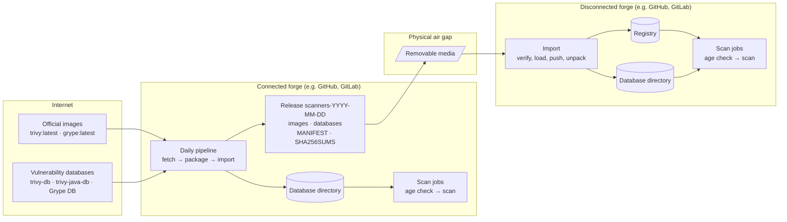

# Architecture

How Trivy and Grype scan container images on a forge with no internet, using scanners and
databases prepared on a connected forge and carried across on removable media. The decisions
behind it are in [ADR-0001](decisions/0001-scanner-images-and-databases.md).



## Scanners and their databases are separate things

The official Trivy and Grype images hold only the scanner. Each downloads its vulnerability
database when a scan starts. So keeping the images current isn't enough: the databases have to
be fetched, carried and installed too.

| Database | What it holds | Rebuilt | Size (compressed) |
|---|---|---|---|
| **trivy-db** | Vulnerabilities for OS and language packages | every 6 hours | 133 MB |
| **trivy-java-db** | An index from a JAR's SHA-1 to its Maven name and version. No vulnerabilities. | daily | 983 MB |
| **Grype DB** | Grype's vulnerabilities | daily | 190 MB |

Trivy uses the Java index only for JARs that don't say what they are (no `pom.properties` or
`MANIFEST.MF` details). It still has to be present: offline, Trivy refuses to scan an image
containing a JAR without it. An old copy misses only library versions released since it was
built, never a vulnerability. That's why it can be downloaded less often than the others
(`fetch.sh --java-db-refresh-days N`) and has its own age threshold.

## The parts

**Daily pipeline (connected forge).** A scheduled job:

1. pulls the latest official images and pins each by digest;
2. downloads the three databases, using those images (Grype's archive is checked against the
   sha256 in Grype's own listing);
3. packages a dated release;
4. imports that release into its own database directory, exactly as the disconnected side will.

Image pipelines on the connected forge then scan with it: whenever an image is pulled or
updated, they run the age check and both scanners against the database directory.

**The release.** One directory, about 1.4 GB:

```
scanners-2026-10-14/
  images/trivy-0.75.0.tar.gz          the official images, saved
  images/grype-0.120.1.tar.gz
  db/trivy-db.tar.gz
  db/trivy-java-db.tar.gz
  db/grype-db.tar.zst
  MANIFEST                            versions, image digests, each database's build time
  SHA256SUMS                          a checksum for every other file
```

**Carry.** Copy the directory onto removable media and off again on the other side, under the
customer's media-handling rules.

**Import (disconnected forge).**

1. Verify every checksum. One changed or missing file stops the import before anything is
   loaded.
2. Load the images, and push them to the forge's registry.
3. Unpack the databases into a new directory and swap it in whole. The previous one is kept for
   rollback.

**The database directory.**

```
/srv/vulndb/
  current/      what scans use: trivy/, grype/, MANIFEST
  previous/     the one before, for rollback
```

Runners mount it read-only. With several runner hosts, import on each, or put it on a share. For
example, on GitLab, add to the runner's `config.toml`:

```toml
[runners.docker]
  volumes = ["/srv/vulndb:/srv/vulndb:ro"]
```

If your forge runs each job inside the scanner image (e.g. GitLab's Docker executor) rather than
calling `docker run` from a shell, Grype's plain image has no shell to run the job. Set
`GRYPE_IMAGE_REF=ghcr.io/anchore/grype:debug`: the same release, plus a busybox shell.

**Scan jobs (both forges).**

1. **Age check.** Reads each database's build time from the data itself. Past 7 days
   (configurable; the Java index has its own setting), it logs a warning naming the database
   and its age. It never fails the job: an old database is a reason to carry a new release, not
   a reason to stop scanning.
2. **Trivy and Grype**, each in its official image, with no network, the database directory
   mounted read-only, and every update, version check and telemetry call turned off.

## Where things are checked

| Check | Where | On failure |
|---|---|---|
| Grype's archive against the sha256 in its listing | daily pipeline | no release that day |
| Every file against `SHA256SUMS` | import | nothing is loaded |
| Each database's age | before every scan | a warning; the scan runs |
| No network calls | every scan runs with networking disabled | the scan fails instead of reaching out |

`SHA256SUMS` travels with the release, so it catches damage in transit, not a deliberate change by
someone who can also rewrite `SHA256SUMS`. Guarding against that takes signing, which this example
leaves out. A lighter step is to send the hash of `SHA256SUMS` itself by a separate channel and
compare it before importing.

## When things go wrong

* **The daily pipeline fails** (e.g. a database host is down). There's no new release that day,
  and scans keep using the last one. After 7 days they start warning. This is the difference from
  wd2l's failure: a database outage delays updates; it doesn't stop scans.
* **A release is damaged in transit.** Import names the file and stops; the current databases
  stay in place.
* **A bad release is imported.** Swap `previous/` back into `current/`.

## Networks

The demo runs every scan with networking disabled, which proves the scanners make no calls of
their own. In a real disconnected forge, a scan job may still pull the image it scans from the
forge's internal registry. That needs only the internal network.

## Sizes and timing

Measured on a GitHub-hosted runner (ubuntu-24.04), 2026-10-14:

| Step | Time | Notes |
|---|---|---|
| fetch | 37 s | two image pulls and about 1.3 GB of databases |
| package | 100 s | mostly compressing the Java index again; the release is 1.4 GB |
| import | about 100 s | mostly unpacking the Java index and installing Grype's database |
| scan | 6 s | both scanners, one image, no network |

Two-thirds of each release is Trivy's Java index. Downloading it less often
(`--java-db-refresh-days`) saves the download, not the release size: every release still carries
it.
