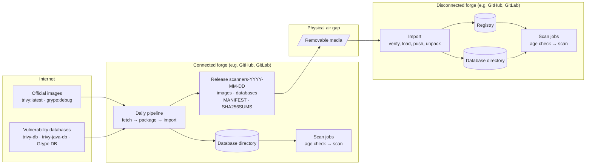

# airgap-vuln-scan: design

**Issue:** #1. **Date:** 2026-10-13. **Status:** draft, for review.
**Decisions:** [ADR-0001](../../decisions/0001-scanner-images-and-databases.md).
**Overview for readers:** [architecture.md](../../architecture.md).

## Goal

Show, as plainly as possible, how to scan container images with Trivy and Grype on a system with
no internet:

- a connected forge (e.g. GitHub, GitLab) prepares the scanners and their databases once a day;
- the result is carried across a physical air gap on removable media;
- a disconnected forge loads it and scans its own images, with no network calls at all;
- before each scan, a check warns (and never fails) when a database is more than 7 days old.

A wd2l CI run showed why: Trivy's database mirror returned 404 and the scan failed, though
nothing about the image under test had changed.

**Not in scope:** signing, attestations, SLSA, releases of this repository, and any change to
wd2l.

## Background (checked 2026-10-13)

- **The official images don't contain the databases.** `aquasec/trivy` is Alpine plus git, CA
  certificates and the `trivy` binary. `anchore/grype` is `scratch` plus CA certificates and the
  `grype` binary; its `debug` variant adds a busybox shell. Both download their databases at
  scan time.
- **Images and databases change at different rates.** The tools release every few weeks
  (Trivy 0.75.0 on 2026-10-01, Grype 0.120.1 on 2026-10-06). Trivy's vulnerability database is
  rebuilt every 6 hours, its Java database daily, and Grype's database daily (06:00 UTC).
- **Sizes (compressed):** trivy-db 133 MB, trivy-java-db 983 MB, Grype archive 190 MB.
- **Trivy's Java database is an index, not vulnerability data.** It maps a JAR's SHA-1 to its
  Maven coordinates, for JARs whose own `pom.properties` or `MANIFEST.MF` don't say what they
  are. Java vulnerabilities are in the main database. Offline, if an image contains a JAR and
  the Java database is missing, Trivy's whole scan fails.
- **Trivy offline flags:** `--skip-db-update --skip-java-db-update --skip-check-update
  --offline-scan`, plus `--skip-version-check --disable-telemetry` (both are needed to stop
  calls to `check.trivy.dev`). Build times: `UpdatedAt` in `db/metadata.json` and
  `java-db/metadata.json` under the cache directory.
- **Grype offline settings:** `GRYPE_DB_CACHE_DIR`, `GRYPE_DB_AUTO_UPDATE=false`,
  `GRYPE_CHECK_FOR_APP_UPDATE=false`, and `GRYPE_DB_VALIDATE_AGE=false` (its own check refuses
  a database older than 120 hours, which would stop the scan instead of warning). The listing
  `grype db list` gives the archive's URL, build time and sha256; `grype db import FILE`
  installs it; `grype db status` reports the build time.

## Decisions

1. **The official images are used unchanged.** The databases travel beside them, not inside
   them (ADR-0001).
2. **On each forge, the databases live in a directory that runners mount read-only.** Scan jobs
   download nothing.
3. **Each daily run pulls the latest images and pins them by digest.** Everything after the pull
   uses that exact image.
4. **Every release includes Trivy's Java database.** `fetch.sh --java-db-refresh-days N` sets
   how often it's downloaded again (default 0: every fetch). Between downloads, the release
   carries the last copy.
5. **The Java database has its own age threshold** (default 7 days). If you refresh it less
   often, raise the threshold to match.
6. **Both forges import the same release.** The connected side imports its own release right
   after packaging it, so connected and disconnected scans run the same code on the same data.
7. **In this demo, the release is a workflow artifact kept for 7 days.** A real setup would use
   the forge's release or package feature.

## Architecture



## Components

Five bash scripts in `scripts/`, plus `lib.sh` for what they share. They run on a host with
Docker. Every tool runs in its official image; the host needs only bash, coreutils, sed, curl,
tar, gzip and Docker (no jq, no Python). Containers run as the host user
(`--user "$(id -u):$(id -g)"`, `HOME=/tmp`), so files they write in bind mounts belong to the
runner. In Git Bash, `lib.sh` converts mount paths with `pwd -W`.

### `fetch.sh WORK_DIR [--java-db-refresh-days N]` (connected)

1. Pull `$TRIVY_IMAGE_REF` (default `ghcr.io/aquasecurity/trivy:latest`) and `$GRYPE_IMAGE_REF`
   (default `ghcr.io/anchore/grype:debug`). Record each image's registry digest and version.
   Tag them locally as `airgap-vuln-scan/trivy:<version>` and
   `airgap-vuln-scan/grype:<version>-debug`.
2. Trivy's database: `trivy image --download-db-only --cache-dir WORK_DIR/trivy`.
3. Trivy's Java database: `--download-java-db-only`, unless `WORK_DIR/trivy/java-db` exists and
   was built less than N days ago (N > 0). Log which happened.
4. Grype's database: `grype db list` gives the archive URL, build time and sha256. Download it
   with curl to `WORK_DIR/grype-db.tar.zst` and check the sha256; a mismatch stops the fetch.
5. Write `WORK_DIR/fetch.env`: the values that `package.sh` puts in `MANIFEST`.

`WORK_DIR` persists between runs where the runner allows it, which is what makes Java reuse
work. On a hosted runner it starts empty each time.

### `package.sh WORK_DIR OUT_DIR` (connected)

Writes `OUT_DIR/scanners-YYYY-MM-DD/` (the UTC date; a re-run on the same day replaces it):

```
images/trivy-<v>.tar.gz           docker save | gzip
images/grype-<v>-debug.tar.gz
db/trivy-db.tar.gz                tar of WORK_DIR/trivy/db
db/trivy-java-db.tar.gz           tar of WORK_DIR/trivy/java-db
db/grype-db.tar.zst               Grype's own archive, unchanged
MANIFEST
SHA256SUMS                        sha256sum of every other file
```

`MANIFEST` is `KEY=value` lines, one per line. Scripts read it with `sed`; they never `source`
it, because it comes from removable media.

```
RELEASE=scanners-2026-10-14
CREATED=2026-10-14T07:12:03Z
TRIVY_VERSION=0.75.0
TRIVY_SOURCE=ghcr.io/aquasecurity/trivy@sha256:…
TRIVY_IMAGE=airgap-vuln-scan/trivy:0.75.0
GRYPE_VERSION=0.120.1
GRYPE_SOURCE=ghcr.io/anchore/grype@sha256:…
GRYPE_IMAGE=airgap-vuln-scan/grype:0.120.1-debug
TRIVY_DB_BUILT=2026-10-14T06:20:16Z
TRIVY_JAVA_DB_BUILT=2026-10-14T01:11:59Z
GRYPE_DB_BUILT=2026-10-14T06:35:20Z
```

A release is about 1.5 GB, two-thirds of it the Java database.

### Carry

Copy the release directory to removable media and, across the gap, copy it off. The customer's
own media-handling rules apply; this repo doesn't model them.

### `import.sh RELEASE_DIR VULNDB_ROOT [--registry PREFIX]` (both forges)

1. **Verify:** `sha256sum -c --strict SHA256SUMS` in `RELEASE_DIR`. A changed or missing file
   stops the import before anything is loaded, with the failing file named.
2. **Load:** `docker load` both image archives.
3. **Push** (if `--registry` is given): tag and push `PREFIX/trivy:<v>`, `PREFIX/trivy:latest`,
   `PREFIX/grype:<v>-debug` and `PREFIX/grype:debug`.
4. **Unpack** into `VULNDB_ROOT/incoming/`: `trivy/db`, `trivy/java-db`, and Grype's database
   via `grype db import` (in the Grype image, with no network) into `grype/`. Copy `MANIFEST`
   in: it is the record of what was imported and when each database was built.
5. **Swap:** remove `previous/`, rename `current/` to `previous/` and `incoming/` to `current/`.
   Scans that start after the swap see the new release; none sees half of one. Roll back by
   swapping `previous/` back.

A failure in steps 1 to 4 leaves `current/` untouched.

### `check-age.sh VULNDB_DIR` (both forges)

Reads each database's build time from the data itself: `UpdatedAt` in Trivy's two
`metadata.json` files, and `grype db status` (in the Grype image, with no network).

- For each database, prints one line: name, build time, age in days.
- Past the limit, meaning built more than N × 24 hours ago (N is `MAX_DB_AGE_DAYS` for trivy-db
  and grype-db, `MAX_JAVA_DB_AGE_DAYS` for trivy-java-db; both default to 7), prints
  `WARNING: trivy-db is 9 days old (built 2026-10-05T06:20:16Z); limit 7 days. Import a newer release.`
  On GitHub Actions (`GITHUB_ACTIONS=true`) it also prints a `::warning::` annotation.
- Exits 0 whether databases are fresh or stale. Exits 1 only if a database is missing, because
  the scan can't run without it.
- `AGE_CHECK_NOW` (an ISO 8601 time) replaces the current time. It exists for the tests.

### `scan.sh VULNDB_DIR IMAGE_TAR [REPORTS_DIR]` (both forges)

1. Run `check-age.sh VULNDB_DIR`.
2. Trivy, from `TRIVY_IMAGE` in `VULNDB_DIR/MANIFEST`:
   `docker run --rm --network none -v VULNDB_DIR:/db:ro -v IMAGE_TAR:/scan/image.tar:ro
   TRIVY_IMAGE image --input /scan/image.tar --cache-dir /db/trivy --cache-backend memory
   --skip-db-update --skip-java-db-update --skip-check-update --offline-scan
   --skip-version-check --disable-telemetry --scanners vuln`.
   Table to the log, JSON to `REPORTS_DIR/trivy.json`.
3. Grype, from `GRYPE_IMAGE`: `docker run --rm --network none -v VULNDB_DIR:/db:ro
   -v IMAGE_TAR:/scan/image.tar:ro -e GRYPE_DB_CACHE_DIR=/db/grype -e GRYPE_DB_AUTO_UPDATE=false
   -e GRYPE_DB_VALIDATE_AGE=false -e GRYPE_CHECK_FOR_APP_UPDATE=false GRYPE_IMAGE
   docker-archive:/scan/image.tar`. Table to the log, JSON to `REPORTS_DIR/grype.json`.
4. Findings don't fail the scan. The README shows how to gate on them (Trivy `--exit-code 1
   --severity CRITICAL`, Grype `--fail-on critical`).

`TRIVY_IMAGE` and `GRYPE_IMAGE` can be overridden, e.g. with references to the disconnected
registry. `REPORTS_DIR` defaults to `./reports`.

## Settings

| Setting | Used by | Default |
|---|---|---|
| `TRIVY_IMAGE_REF`, `GRYPE_IMAGE_REF` | fetch | `ghcr.io/aquasecurity/trivy:latest`, `ghcr.io/anchore/grype:debug` |
| `--java-db-refresh-days N` | fetch | 0 (every fetch) |
| `--registry PREFIX` | import | none (load only) |
| `MAX_DB_AGE_DAYS` | check-age, scan | 7 |
| `MAX_JAVA_DB_AGE_DAYS` | check-age, scan | 7 |
| `AGE_CHECK_NOW` | check-age (tests) | the current time |
| `TRIVY_IMAGE`, `GRYPE_IMAGE` | scan | from `MANIFEST` |

## Error handling

| What fails | Result |
|---|---|
| A download in fetch, or Grype's archive checksum | fetch exits non-zero; no release that day. Yesterday's `current/` keeps working, and the age check starts warning after 7 days. |
| A checksum in import | import exits non-zero before loading anything, naming the file. `current/` is untouched. |
| Load, push or unpack in import | import exits non-zero; `incoming/` is left for inspection; `current/` is untouched. |
| A missing database at scan time | check-age exits 1 and the scan doesn't run. |
| A database past its limit | a warning per database; the scan runs. |
| A scanner error | scan exits non-zero. |
| Vulnerabilities found | reported; scan exits 0. |

## CI: how the acceptance criteria are proven

One GitHub Actions workflow, `.github/workflows/demo.yml`: daily at 07:00 UTC (after Grype's
06:00 publish), on pull requests, on pushes to `main`, and on manual dispatch. Actions are pinned
by commit SHA; images by digest. One job plays both forges:

| Step | Proves |
|---|---|
| shellcheck `scripts/*.sh` (pinned `koalaman/shellcheck` image) | the scripts are clean |
| `fetch.sh`, `package.sh`, `import.sh` into a connected root; `scan.sh` on the example image | the connected side works end to end |
| Upload the release as an artifact (7 days; scheduled and manual runs only) | a release exists to carry |
| Start a local registry; `import.sh … --registry localhost:5000/scanners` into a second root | loading into another forge's registry |
| `docker run --network none` the Trivy image with `wget https://mirror.gcr.io`: must fail | the scan containers have no network |
| `scan.sh` on the disconnected root | **a scan completes with no network access** |
| Assert the scan's log has no `WARNING` line | **fresh databases give no warning** |
| `AGE_CHECK_NOW` = now + 8 days; `scan.sh` again; assert one warning for each of the three databases, and the step passes | **a database over 7 days old gives a warning naming it and its age, and the job still passes** |
| Copy the release (hard links, but a real copy of `db/grype-db.tar.zst`, so the original isn't touched), change one byte of that copy, run `import.sh`: must exit non-zero, name the file, and leave `current/MANIFEST` unchanged | **checksums are verified on import, and a changed file is refused** |
| A second `fetch.sh --java-db-refresh-days 30`: log must say the Java database was reused | the Java refresh flag works |
| Review: digests in `MANIFEST`, `docker run` by those images, actions by SHA | **the tools are pinned (images by digest)** |
| The README's walkthrough uses the same commands as the workflow | **the README walks through fetch → carry → import → scan** |

**Example image:** an old public image with both OS packages and JARs, pinned by digest (e.g. an
official Tomcat image from 2021), so both scanners find something and Trivy needs its Java
database. Chosen during the build. The workflow saves it with `docker save`, as the image under
test.

## Testing on the PC

Git Bash and Docker Desktop, no local Python or jq. The same commands as CI, run from Git Bash.
Line endings: `.gitattributes` sets `*.sh text eol=lf`, because the PC checks out with
`core.autocrlf=true`.

## To verify during the build

- Trivy and Grype both work with the database directory mounted read-only, Trivy with
  `--cache-backend memory`. If either needs to write, `scan.sh` copies the directory to a
  temporary one first.
- The output of `docker save` (an OCI layout since Docker 25) works as Grype's
  `docker-archive:` input.
- `date -d` parses Trivy's `UpdatedAt` (nanosecond fractions) and Grype's `built`.
- Disk space on the hosted runner: the Java database unpacks to several GB, and the job holds
  it in three places (fetch, connected root, disconnected root). Use the runner's larger disk
  (`/mnt`) or free space first.
- Running as the host user works in all three images (Trivy, Grype debug, shellcheck).
- The exact Trivy and Grype flags, against the versions pulled on the day of the build.
